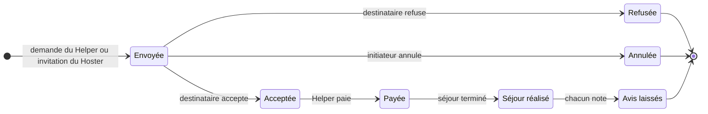

# Hostelp — Backlog fonctionnel

Ce backlog liste les fonctionnalités du nouveau backend Hostelp (Java / Spring Boot). Il part de la version Zend Framework qui était en production et de la refonte Symfony jamais terminée. Chaque fonctionnalité est classée **MVP** ou **Plus tard**.

**Vocabulaire retenu** (ce seront les noms des classes) :

- **Membre** : toute personne inscrite. Un membre peut être Hoster, Helper, ou les deux.
- **Hoster** / **Helper** : un membre qui a créé le profil correspondant. Le Hoster accueille ; le Helper voyage et apporte ses savoir-faire.
- **Savoir-faire** : une compétence du référentiel, géré par un administrateur.
- **Communauté** : une catégorie de savoir-faire.
- **Demande d'échange** : un échange entre un Helper et un Hoster, des dates jusqu'à l'avis. Il est lancé par l'un ou par l'autre : demande du Helper, ou invitation du Hoster.
- **Initiateur** / **Destinataire** : le membre qui envoie la demande d'échange, et celui qui la reçoit.
- **Administrateur** : gère les communautés et le référentiel de savoir-faire.

## Authentification

La connexion Google remplace la connexion Facebook de l'ancien site, abandonnée pour le moment.

| Fonctionnalité | Détail | Priorité |
| --- | --- | --- |
| S'inscrire | E-mail et mot de passe ; un e-mail de confirmation est envoyé | MVP |
| Confirmer son adresse e-mail | Lien avec un jeton à durée limitée ; active le compte | MVP |
| Se connecter | E-mail et mot de passe | MVP |
| Se connecter avec Google | OAuth2 | MVP |
| Se déconnecter | | MVP |
| Réinitialiser son mot de passe | Un seul parcours : mot de passe oublié, lien à usage unique par e-mail, nouveau mot de passe | MVP |

## Communauté et savoir-faire

Comme dans l'ancien code, une communauté est une catégorie de savoir-faire : un membre en fait partie à travers ses savoir-faire, sans adhésion explicite. « Rejoindre » et « se retirer » d'une communauté disparaissent donc. Le choix de ses propres savoir-faire se fait dans le profil.

| Fonctionnalité | Détail | Priorité |
| --- | --- | --- |
| Gérer les communautés | Administrateur : créer, modifier, supprimer une catégorie | MVP |
| Gérer le référentiel de savoir-faire | Administrateur : créer, modifier, supprimer un savoir-faire et le rattacher à une communauté | MVP |
| Consulter les communautés et leurs savoir-faire | Tout visiteur | MVP |

## Profil

Un membre devient Hoster ou Helper en créant le profil correspondant ; il peut avoir les deux.

| Fonctionnalité | Détail | Priorité |
| --- | --- | --- |
| Devenir Hoster | Créer son profil Hoster : logement proposé et savoir-faire recherchés. Le logement décrit les conditions (fumeur, animaux, fêtes), la période d'ouverture, la surface, le nombre de lits, les règles de la maison et les équipements | MVP |
| Devenir Helper | Créer son profil Helper : entre 1 et 5 savoir-faire proposés | MVP |
| Modifier son profil | Profil Hoster ou Helper | MVP |
| Supprimer son profil | Profil Hoster ou Helper ; le compte reste actif | MVP |

## Membres

Une seule recherche remplace les anciennes listes de Hosters et de Helpers ; le rôle devient un filtre.

| Fonctionnalité | Détail | Priorité |
| --- | --- | --- |
| Lister les membres | | MVP |
| Afficher les détails d'un membre | | MVP |
| Filtrer les membres | Rôle, savoir-faire, localisation, destination, dates | MVP |
| Ajouter un membre en favori | | Plus tard |

## Demande d'échange

Une demande porte sur des dates et des savoir-faire échangés. Elle peut partir du Helper (demande) ou du Hoster (invitation) ; dans les deux cas, c'est le destinataire qui accepte ou refuse. Elle suit un cycle allant de l'envoi jusqu'aux avis, et le paiement débloque le partage des coordonnées du Hoster.

Refusée et Annulée sont des états finaux ; le délai d'annulation reste à définir.

**Règle du MVP :** le cycle s'arrête à l'état Acceptée. Les coordonnées du Hoster sont partagées au Helper dès l'acceptation, et la série d'e-mails de préparation part à ce moment-là. Le paiement s'insérera plus tard entre l'acceptation et le partage des coordonnées.

| Fonctionnalité | Détail | Priorité |
| --- | --- | --- |
| Envoyer une demande d'échange | Helper vers Hoster : dates du séjour et savoir-faire échangés | MVP |
| Inviter un Helper | Hoster vers Helper : dates du séjour et savoir-faire échangés | MVP |
| Lister mes demandes | Envoyées et reçues, demandes et invitations | MVP |
| Annuler une demande envoyée | Initiateur ; délai à définir | MVP |
| Accepter une demande | Destinataire | MVP |
| Refuser une demande | Destinataire | MVP |
| Payer la mise en relation | Le paiement partage les coordonnées du Hoster au Helper | Plus tard |
| Préparer le voyage | Série d'e-mails pour guider les deux membres et optimiser l'expérience ; au MVP, déclenchée à l'acceptation | MVP |
| Clôturer le séjour | Déclencheur à définir (voir questions ouvertes) | Plus tard |
| Laisser un avis | Chacun note l'autre, comme sur Airbnb | Plus tard |

## Minichat

Le minichat permet aux membres d'échanger entre eux pour les aider à décider. « Inviter un membre » est retiré : c'était un doublon de la demande d'échange.

| Fonctionnalité | Détail | Priorité |
| --- | --- | --- |
| Envoyer un message et y répondre | Conversation entre deux membres | MVP |
| Supprimer un message | | MVP |
| Dicter un message | Speech-to-text | Plus tard |
| Passer un appel vidéo | | Plus tard |
| Traduire les messages | Traduction instantanée | Plus tard |

## Notifications par e-mail

Les e-mails ne sont pas des fonctionnalités : chacun est déclenché par un événement d'une autre section. Techniquement, ce seront des événements de domaine.

| Événement | E-mail envoyé | Destinataire |
| --- | --- | --- |
| Inscription | Lien de confirmation de l'adresse | Nouveau membre |
| Mot de passe oublié | Lien de réinitialisation | Membre |
| Demande d'échange ou invitation envoyée | Nouvelle demande ou invitation | Destinataire |
| Demande acceptée ou refusée | Réponse à la demande ; au MVP, avec les coordonnées du Hoster si elle est acceptée | Initiateur (et Helper pour les coordonnées) |
| Demande annulée | Annulation | Destinataire |
| Paiement effectué | Coordonnées du Hoster | Helper |
| Avant le séjour | Série d'e-mails de préparation du voyage | Hoster et Helper |
| Séjour réalisé | Invitation à laisser un avis | Hoster et Helper |

## Questions ouvertes

- [ ] Jusqu'à quand peut-on annuler une demande envoyée ?
- [ ] Paiement : qui paie, combien, à quel moment ? Rembourse-t-on en cas d'annulation après paiement ?
- [ ] Qui déclare le séjour réalisé : automatiquement à la date de fin, ou par confirmation des deux membres ?
- [ ] Un membre peut-il supprimer tout son compte (RGPD), et pas seulement un profil ?
- [ ] Un membre peut-il proposer un savoir-faire absent du référentiel ?
- [ ] Peut-on écrire à un membre dans le minichat avant qu'une demande soit acceptée ? Si oui, quel garde-fou contre le spam ?
- [ ] Garde-t-on l'inscription à la newsletter de l'ancien site ?
- [ ] Un Hoster peut-il inviter n'importe quel Helper, ou seulement ceux qui proposent un savoir-faire qu'il recherche ?
- [ ] Combien de temps une demande ou une invitation reste-t-elle valable sans réponse avant d'expirer ?